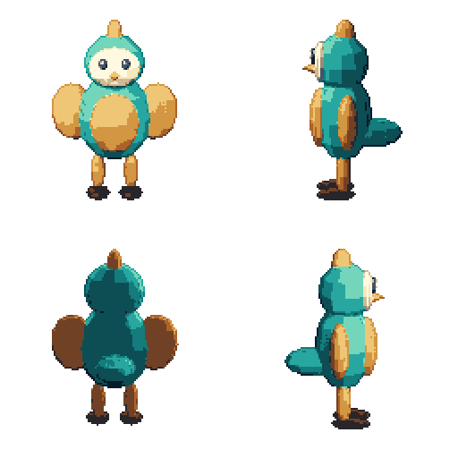

# Pixel Pipeline Kit

把参考动作整理成可靠的透明序列帧，把三维动画渲成固定网格的像素角色。两个可独立安装的 Agent Skill，配套本地 Python / Blender 工具。

## 当前能力

- **序列帧制作**。原生透明素材、小批四帧重建指引、2×2 参考图、固定网格切片、整帧校准、逐像素改点、真实视频 PTS 选帧。输出保留原色和 Alpha 的 PNG、图集、逐帧毫秒与 GIF 预览。
- **离线 3 渲 2**。读取 .blend、GLB 或 glTF，用统一正交相机和根点渲染多个方向与动画。输出对齐的色图、相机法线、归一化深度与材质分组，可按分组锁色并生成轮廓。

AI 生图与视频由使用者选择的工具提供。Skill 负责参考组织、制作约束与检查，当前 CLI 处理已有文件。视频动作参考与已认可母版可一起用于原生透明四帧重建。生成服务的账号、费用及可用性由对应服务管理。

## 直接复现

需要 Python 3.9+、Pillow、NumPy 和 Blender。可选视频选帧需要 FFmpeg / FFprobe。以下命令从仓库根执行，`blender` 请换为本机可执行文件或加入 PATH。

~~~sh
python -m pip install -r requirements.txt
blender --background --python-exit-code 1 --python examples/make_demo.py -- .build/bird.blend
blender --background --python-exit-code 1 --python skills/blender-sprite-render/scripts/render_sprites.py -- --input .build/bird.blend --config examples/render.json --output .build/render
python skills/blender-sprite-render/scripts/finish_sprites.py --input .build/render --palettes examples/palettes.json --output .build/sprites
python skills/sprite-sequence/scripts/pixel_sequence_tools.py export --frames .build/sprites/S/frames --timings .build/sprites/S/timing.json --anchor 64 112 --output .build/sequence
~~~

结果在 `.build/sprites/{S,E,N,W}/`，各方向含八帧 128×128 PNG、辅助通道、图集和时序。机械小鸟由随仓库的脚本创建，可继续编辑。所有命令使用新输出目录，成功后才移入最终路径，重复执行时换一个输出名称。

## 用作 Skill

把 `skills/sprite-sequence` 或 `skills/blender-sprite-render` 复制到你的 Agent 技能目录。同名目录先比较差异，再安装需要的版本。两个目录各自带齐自己的脚本与说明。

可以直接给 Agent 这样的任务

> 使用 sprite-sequence，依据我的角色母版和动作参考，先重建一条完整循环。每批四帧，保留原生透明、同一画布、根点和逐帧时序。先给原尺寸与整数倍预览。

> 使用 blender-sprite-render，把这个已有动画的模型导成四向透明像素序列帧。先核对模型朝向、像素尺度和完整动作边界，再固定相机批量渲染。

具体入口在两个目录的 [SKILL.md](skills/sprite-sequence/SKILL.md) 和 [渲染 Skill](skills/blender-sprite-render/SKILL.md)。

## 现有序列帧工具

~~~sh
python skills/sprite-sequence/scripts/pixel_sequence_tools.py batch-guides --frames .build/sprites/S/frames --output .build/guides
python skills/sprite-sequence/scripts/pixel_sequence_tools.py slice-sheet --input .build/sprites/S/sheet.png --rows 1 --cols 8 --anchor 64 112 --output .build/sliced
python skills/sprite-sequence/scripts/pixel_sequence_tools.py repair-cels --help
python skills/sprite-sequence/scripts/pixel_sequence_tools.py replay-edits --base .build/sprites/S/frames/frame_0000.png --recipe examples/blink.json --output .build/blink
python skills/sprite-sequence/scripts/extract_video_frames.py --help
~~~

[显式修复与改点配方](skills/sprite-sequence/references/recipes.md) · [相机、网格与材质分组配置](skills/blender-sprite-render/references/configuration.md)

## 适用范围与维护

本次验证使用 macOS arm64、Python 3.9 与 Blender 5.2.2。Windows/Linux 和其他 Blender 版本欢迎反馈实际结果。3 渲 2 当前为离线 RGBA 导出，实时引擎合成有单独的演进空间。相机法线为几何参考通道，深度采用 RGB8 归一化，透明表面和很细的轮廓需要人工核对。像素输出使用二值 Alpha，原始 RGBA 渲染留在原目录。GIF 只作预览，PNG 与 JSON 保存完整颜色和时间。

两个 Skill 共用相同的画布、根点与逐帧毫秒约定。先保持小而清楚的命令行接口，再依据真实问题增加导入器。提交问题请附最小自有素材、命令、工具版本和预期结果，并先清理私人元数据。维护约定见 [CONTRIBUTING.md](CONTRIBUTING.md)。

## 许可与来源

原创代码、文档及示例按 [MIT](LICENSE) 提供。GIF 编码与序列处理沿用了 Agent Sprite Forge 的部分实现，保留 [上游 MIT 声明](licenses/agent-sprite-forge-MIT.txt)。具体范围见 [THIRD_PARTY_NOTICES.md](THIRD_PARTY_NOTICES.md)。

使用者提供的素材及第三方服务产物沿各自权利与条款处理。Blender、Python 库及 FFmpeg 作为外部依赖使用各自许可。
